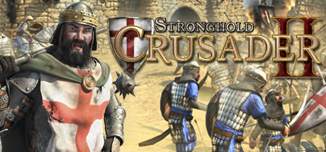

**Stronghold Crusader is the classic castle-building RTS set in the Crusades, where you manage desert-adapted economies and build castle defenses against waves of attacking forces. Features the legendary Crusader Trail with 50 increasingly brutal skirmish scenarios.**

---

## 📖 About

Stronghold Crusader is the classic castle-building RTS set in the Crusades, where you manage desert-adapted economies and build castle defenses against waves of attacking forces. Features the legendary Crusader Trail with 50 increasingly brutal skirmish scenarios.

## ⚠️ Problems Without Trainer

| Problem | Status |
|---------|--------|
| **Crusader Trail** — Later trail missions feature overwhelming enemy counts that require perfect economy | ✅ Solved |
| **Desert Resource** — No apple orchards mean intricate trade-based food supply chains | ✅ Solved |
| **Fire Management** — Enemy fire throwers can demolish poorly defended castle sections rapidly | ✅ Solved |
| **Population Caps** — Happiness and food management for large armies is very demanding | ✅ Solved |

## ✅ Solution

The **Stronghold Crusader Trainer** solves all these issues by giving you complete control over the game.

## 🎯 Full Feature List

- Unlimited Resources
- God Mode / Invincibility
- Instant Skill Cooldown
- One-Hit Kill
- Freeze Game Timer
- Unlock All Items & Achievements
- Custom Speed Multiplier
- Save State Anywhere

## 🚀 Quick Start

1. **Disable Windows Defender** temporarily (trainer may trigger false positive)
2. Download the trainer from the button above
3. Launch Stronghold Crusader
4. Run the trainer as Administrator
5. Activate desired cheats with hotkeys

## 💎 Free vs Paid

| Feature | Free | Pro |
|---------|------|-----|
| Basic God Mode | ✅ | ✅ |
| Unlimited Resources | ✅ | ✅ |
| All Advanced Cheats | ❌ | ✅ |
| Auto-Updates | ❌ | ✅ |
| Priority Support | ❌ | ✅ |

## 💻 Requirements

- Windows 10/11 (64-bit)
- Stronghold Crusader (any version)
- .NET Framework 4.8+
- DirectX 11+

## 🍎 macOS

macOS users can use our alternative tool:

## ⚖️ Legal

This trainer is for educational and single-player use only. Use responsibly.

---

